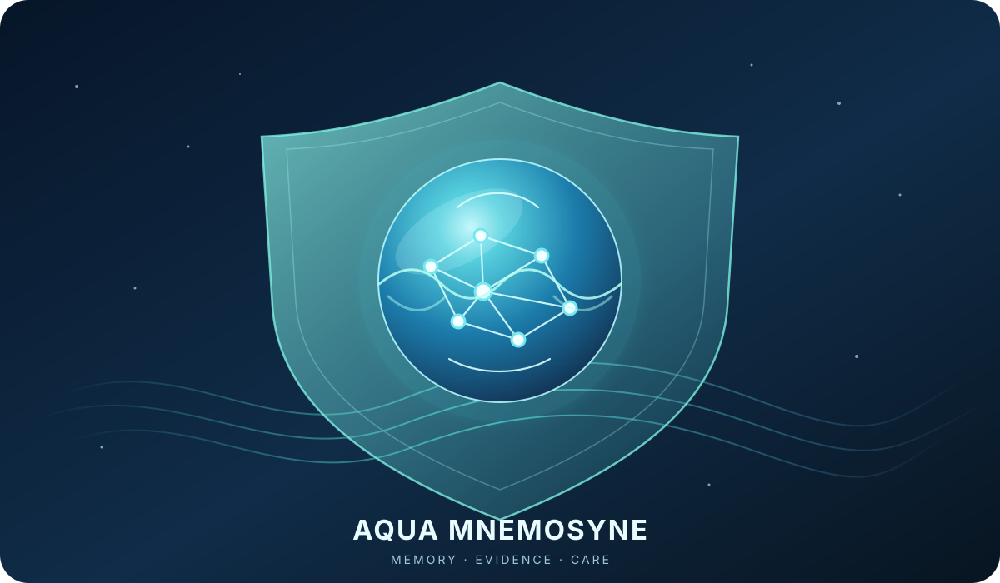

# Aqua Mnemosyne

*An encyclopedia-style overview of the proposed memory, evidence, and care
architecture of Aqua Mnemosynth.*

*Illustration: a connected record-space held within a protective current. The
image is symbolic; it does not depict a deployed system or autonomous agent.*

> **Scope note.** This is an original, neutral encyclopedia-style overview, not
> a Wikipedia article. It distinguishes the project's conceptual architecture
> from the software currently in this repository. Descriptions of how the
> proposed safeguards can protect vulnerable people are design goals, not
> demonstrated outcomes.

## Contents

1. [Overview](#1-overview)
2. [Name and metaphor](#2-name-and-metaphor)
3. [Background and conceptual lineage](#3-background-and-conceptual-lineage)
4. [Purpose and scope](#4-purpose-and-scope)
5. [Principles](#5-principles)
6. [Architecture](#6-architecture)
7. [Functions](#7-functions)
8. [AGLA review cycle](#8-agla-review-cycle)
9. [Evidence and memory lifecycle](#9-evidence-and-memory-lifecycle)
10. [Protection of vulnerable people](#10-protection-of-vulnerable-people)
11. [Ethics, privacy, and misuse limits](#11-ethics-privacy-and-misuse-limits)
12. [Current implementation](#12-current-implementation)
13. [Limitations and risks](#13-limitations-and-risks)
14. [Governance and validation](#14-governance-and-validation)
15. [Future development and related pages](#15-future-development-and-related-pages)

---

## 1. Overview

Aqua Mnemosyne is the proposed memory and evidence-integrity aspect of Aqua
Mnemosynth, a project concerned with representing claims, evidence, context,
uncertainty, and reasoning in a way that can be inspected and revised. Its
central purpose is not to produce an authoritative story about people. It is to
help human reviewers retain where information came from, separate source
material from interpretation, compare explanations, and document why a
conclusion changed.

The name is used here for a design concept rather than a standalone product
with a verified operational history. The intended architecture includes
provenance records, structured analysis, adversarial review, privacy checks,
and correction history. AGLA supplies a proposed five-stage working cycle:
Observe, Project, Pattern, Break, and Rotate. Together, these ideas describe a
disciplined process for reviewing public records or other properly authorized
information.

The repository currently implements only a small portion of this vision. Its
evidence prototype records a filename, a SHA-256 digest, and a timestamp in
SQLite; it does not retain the uploaded file contents, establish source
authenticity, or offer the full AGLA workflow. The local API now requires a
configured password, but the password does not encrypt the database file or
make it suitable for sensitive casework. The conceptual framework must
therefore not be represented as an operational tool for sensitive
investigations or case management.

## 2. Name and metaphor

“Aqua” evokes movement, context, and the flow of information. “Mnemosyne” is
the name of the Greek personification of memory and is used by the project as
a metaphor for retaining context and prior states. “Aqua Mnemosyne” therefore
suggests memory that can be examined as information moves through a system.

The accompanying illustration shows a luminous archive of connected points
inside a water-like sphere, surrounded by a shield and flowing lines. The
points represent records and relationships; the shield represents proposed
constraints on disclosure and interpretation; the currents represent
revisions and context. None of these visual elements implies that the
software guarantees protection, stores a complete history, or behaves like a
living organism.

The word “organism” in the project's related architecture is likewise
figurative. It refers to a collection of evolving methods and software
components, not to an autonomous intelligence with agency, intent, or
authority. The system's outputs require human interpretation and review.

## 3. Background and conceptual lineage

Project materials describe a lineage of ideas: passive diagnostics instead of
retaliatory mechanisms; historical context; records and metadata integrity;
contextual memory; anomaly analysis; recursive falsification; and a combined
review architecture. In that account, Aletheia-Core represents a shift toward
observation, Mnemosyne represents memory and provenance, and AGLA represents a
repeatable cycle for testing assumptions.

These are descriptions of a submitted conceptual history. They are not,
without independent evidence, verified software versions, peer-reviewed
results, or proof of deployments. The broader integrated architecture
specifically distinguishes this narrative from implementation status and
notes that the cited case-study claims require separate verification.

In the current project, the most concrete related capabilities are a FastAPI
and Streamlit evidence-recording prototype and a numerical Hatano–Nelson
lattice module. The lattice model is a mathematical component and does not
implement OSINT analysis. The evidence prototype provides a basic digest
comparison, not a full contextual archive. The conceptual lineage is useful
for organizing future design decisions, but should not be confused with a
feature inventory.

## 4. Purpose and scope

The proposed purpose is to support careful review of records and
system-level processes. Potential uses include documenting source provenance,
comparing reporting timelines, identifying missing or inconsistent
documentation, and making uncertainty visible in an audit narrative. A
well-bounded analysis starts with a defined question, a specific audience,
lawful source access, and a clear statement of what is not being investigated.

The design is not intended to determine guilt, rank suspects, infer private
behavior, or replace a court, regulator, journalist, social worker, or
qualified investigator. It should not contact people, direct enforcement,
recommend coercive intervention, or translate correlation into accusation.
Recommendations should concern documented institutional processes and
controls, not personal blame.

The project also distinguishes observation from interpretation. A source
record can support a narrow statement about what that record says; it does not
automatically establish that the statement is complete, accurate, or
independently corroborated. Reports must explain the difference between the
record, the transformation applied to it, and the analyst's inference. This
scope limitation is essential whenever records concern vulnerable people or
allegations of wrongdoing.

## 5. Principles

The design combines several principles:

* **Provenance:** retain references to the source, collection date, locator,
  transformation, and known limitations.
* **Separation:** keep empirical records, formal operations, and interpretive
  recommendations distinct.
* **Falsifiability:** specify what would weaken or disprove an explanation
  before presenting it as a finding.
* **Uncertainty:** record gaps, ambiguity, conflicting evidence, and
  alternative explanations rather than hiding them in a single score.
* **Data minimization:** collect and expose only information needed for a
  legitimate, bounded purpose.
* **Human accountability:** require named roles and qualified review for
  consequential decisions.
* **Correction:** preserve the history of revisions so that a correction does
  not erase the fact that an earlier version existed.
* **Non-retaliation:** provide analysis and documentation, not automated
  punishment or intervention.

These principles are normative requirements for a future system, not a claim
that each is technically enforced by the current application. In particular,
append-only database triggers and hashes offer only limited checks: they do
not prove who supplied a document, whether it was complete, or whether someone
with direct database access changed it.

## 6. Architecture

The proposed architecture has three analytic layers. **Layer I, empirical,**
contains source artifacts or careful references to them, such as document
identifiers, page numbers, dates, and access conditions. **Layer II, formal,**
contains normalized fields, comparison rules, candidate links, uncertainty,
and falsification results. **Layer III, interpretive,** contains ethical
review, implications, limitations, and recommendations. Interpretations may
suggest a question for further research, but they cannot validate a source
claim.

Around these layers are supporting functions. A provenance or Mnemosyne
function tracks source relationships and revisions. A PHCA-style context
function describes system boundaries and conditions. Recursive review
compares hypotheses as evidence changes. The Blade or adversarial function
looks for disconfirming evidence and alternative explanations. The Kindness
Gate reviews potential privacy and dignity harms before material is shared.
The AGLA cycle coordinates the work.

This conceptual design is described in more detail in
[Integrated-Architecture.md](Integrated-Architecture.md). The repository
does not yet implement these complete layers or their automated interactions.

## 7. Functions

The proposed functions are complementary and bounded:

1. **Record references:** associate claims with sources and precise locators.
2. **Normalize cautiously:** convert records to structured fields while
   retaining original wording and transformation notes.
3. **Compare:** evaluate dates, categories, or aggregate indicators under
   explicit methods.
4. **Generate hypotheses:** offer candidate explanations without silently
   choosing one.
5. **Attempt falsification:** search for mismatches, missing links, or
   alternative causes.
6. **Review harm:** assess privacy, consent, identifiability, and foreseeable
   misuse before disclosure.
7. **Report:** produce a qualified account of methods, evidence, uncertainty,
   and unresolved questions.
8. **Correct:** record challenges and corrections without rewriting the
   historical review trail.

These functions should operate on records and institutional mechanisms, not
on an automated profile of a person. A correlation is a prompt for careful
review, not evidence of intent. A threshold crossing is a signal to examine
the data and assumptions, not a verdict. The current evidence prototype
performs only basic file hashing and recording; it does not implement these
analysis functions.

## 8. AGLA review cycle

AGLA is presented as an iterative process:

1. **Observe:** identify a source artifact or measure a system-level indicator
   and record how it was obtained.
2. **Project:** state a bounded research question, intended use, audience, and
   exclusions.
3. **Pattern:** compare records using a disclosed method and note candidate
   relationships without overstating them.
4. **Break:** test source quality, mechanism, alternative explanations,
   confounding factors, and missing records.
5. **Rotate:** revise the question or method, preserve what changed, and begin
   another cycle if appropriate.

The transition from Break to Rotate is mandatory in the submitted model. If a
candidate link does not survive review, the inference is suppressed. It is
not escalated to a lead, target, or allegation. The underlying source can
remain in a lawful archive with its own provenance, but an unsupported
interpretation should not be retained as a factual conclusion.

An operational implementation would need to define who may perform each
step, what qualifies as an adequate source, how dissent is recorded, and when
analysis stops. Reviewers should not treat completion of the cycle as
automatic certification. The quality of the result depends on the quality of
the records, methods, reviewers, and safeguards.

## 9. Evidence and memory lifecycle

A responsible lifecycle begins before collection. The analyst records the
question, authority or public access basis, intended use, retention period,
and data that must not be collected. Each item then receives a source
reference, collection timestamp, exact locator, and notes about redactions,
provenance, and completeness. Any parsing or transformation should be
repeatable and logged.

Analysis should distinguish raw source material from normalized data and
derived claims. Each relationship should link to the records and operations
that produced it. Updates should add a new version or correction record
rather than silently overwriting an earlier interpretation. Reviewers should
be able to determine which information was available at the time a report was
prepared.

Retention and access are part of the lifecycle. Information should be retained
only as long as needed for a legitimate purpose, with special restrictions for
sensitive personal records. Access, export, correction, and deletion
procedures should be documented. Hashes can help detect some byte-level
changes when compared with a trusted prior digest, but a hash alone does not
prove source authenticity or secure the database. The current prototype's
SQLite triggers are not immutable storage.

## 10. Protection of vulnerable people

The architecture can reduce certain risks if its safeguards are implemented
and followed:

* **Minimize exposure:** avoid collecting victim names, addresses, contact
  information, health details, or other identifying attributes unless they
  are strictly necessary and specifically authorized.
* **Prevent association-based accusations:** require a documented mechanism
  and evidence link; mere proximity, shared records, or social connection is
  insufficient.
* **Respect redactions and consent:** do not reverse redactions, republish
  protected material, or expose someone because information is technically
  discoverable.
* **Suppress unsafe outputs:** quarantine a report that could reveal a
  person's identity, location, or vulnerability, or could encourage
  harassment or retaliation.
* **Keep humans accountable:** do not let an algorithm make referrals,
  accusations, or interventions. Sensitive decisions require qualified
  human review and a clear authority.
* **Show uncertainty:** label unverified claims and missing data so that
  readers are less likely to mistake an inference for an established fact.
* **Support correction:** provide a process for challenges, updates, and
  removal of harmful or inaccurate material where appropriate.

These mechanisms aim to protect dignity, privacy, and due process while still
allowing system-level questions to be examined. They cannot guarantee safety.
The repository currently has no dedicated victim-protection, access-control,
consent, or case-management features; it should not be used to store sensitive
case information.

## 11. Ethics, privacy, and misuse limits

Openly available information can still be sensitive. Aggregating public
records may create new risks by making a person easier to identify, locate, or
target. A responsible process therefore evaluates the consequences of
collection and publication, not only whether an item is technically public.
Particular caution is needed for survivors, children, missing persons,
witnesses, and people named in allegations that have not been adjudicated.

The proposed Kindness Gate is an ethical review checkpoint, not a technical
control or a substitute for law, professional standards, or consultation with
affected communities. Review should ask whether the information is necessary,
whether a less identifying version can answer the question, who could be
harmed, and whether the same result could be achieved through aggregate
reporting.

Misuse limits include no unauthorized access, covert surveillance,
doxxing, public suspect ranking, guilt-by-association output, automated
accusation, or coercive action based on a model result. A project that cannot
enforce appropriate access and review should not handle sensitive data.
Operators should document incidents, restrict distribution, and provide a
clear route to challenge or correct published errors.

## 12. Current implementation

The current repository is a small prototype, not the complete conceptual
system:

* A FastAPI endpoint accepts a file, computes its SHA-256 digest, and stores
  the filename, digest, and timestamp in SQLite.
* A verification endpoint compares a supplied digest with the latest database
  record for a filename, and a file-upload endpoint compares a new file's
  digest with recorded digests.
* A Streamlit interface provides local upload and verification workflows.
* A configured password is required for API access; Docker Compose binds its
  published ports to loopback.
* Uploads are limited to 10 MiB.
* The SQLite schema has triggers that reject ordinary SQL update and delete
  statements. Startup also checks basic database integrity and record format.
* `core/lattice.py` contains a separate real-hopping Hatano–Nelson numerical
  model with tests and a plotting command.

The uploaded bytes are not retained as evidence, source identity is not
verified, and the password does not encrypt the SQLite file. A person with
direct access to the database can alter records or triggers, including
well-formed values that basic startup checks cannot detect. These limits mean
the prototype is suitable only for local experimentation, not a forensic
chain of custody or a production service involving vulnerable people.

## 13. Limitations and risks

The conceptual system faces familiar data and inference problems. Public
records can be incomplete, delayed, inconsistent, misindexed, or corrected
after publication. Entity resolution can conflate people with similar names.
Missing data can create apparent gaps; differences in reporting practices can
distort comparisons. A numerical threshold can amplify a poor baseline or
reflect seasonality rather than an exceptional event.

Human review also has limits. Multiple reviewers may share the same source
bias, and agreement is not independent confirmation if they rely on the same
documents or tools. A framework vocabulary can create false confidence if
terms such as “anomaly,” “network,” or “deviation” are not operationally
defined. A cryptographic digest can check equality to a known digest, but it
does not establish who created a file or whether it is truthful.

Accordingly, outputs should state what is unknown and avoid definitive
language unsupported by the records. The supplied EFTA/DOJ figures and
allegations in earlier source material are not independently validated by
this repository and should not be repeated as findings without independent
primary-source review.

## 14. Governance and validation

Governance should assign responsibility for collection, analysis, privacy
review, publication, correction, and incident response. Reviewers should
record conflicts of interest, disagreements, and reasons for suppressing an
inference. High-impact publication should receive independent review,
including expertise relevant to the records and potential harms.

Validation requires more than a successful demonstration. A reproducible
evaluation would publish or securely document the source corpus and access
basis, schemas, transformation logic, query definitions, exclusion and
suppression logs, and limitations. Independent reviewers should reproduce
calculations against primary sources and measure false positives, missed
cases, sensitivity to missing data, and effects of alternate baselines.
Privacy, bias, security, and misuse reviews should occur before deployment
and whenever the use changes.

The submitted AGLA-OSINT material describes several data products and
validation claims but also lists core source code, schemas, and raw outputs
as pending. The claims therefore cannot be treated as independently
reproducible validation based on the provided materials alone. The broader
project's [integrated architecture](Integrated-Architecture.md) lists
conditions for describing the pipeline as validated or ready for deployment.

## 15. Future development and related pages

Potential future work includes a source-reference schema, versioned
transformations, a privacy and retention policy, safe aggregate reporting,
and scenario-based tests for ambiguity, contradictory evidence, and
re-identification risk. Any analysis feature should be developed only after
requirements define its intended users, lawful data basis, failure modes, and
review process. Building an automated people-search or suspect-ranking
function would be outside the stated protective scope.

Useful repository references:

* [Project overview](Overview.md) — mission, intended scope, and non-goals.
* [Architecture](Architecture.md) — conceptual layers and invariants.
* [Integrated architecture](Integrated-Architecture.md) — the AGLA-OSINT and
  Digital Organism synthesis, with implementation and validation boundaries.
* [Risk and liability model](Risk-and-Liability.md) — transparent risk
  dimensions and limits on legal conclusions.
* [Methodology](Methodology.md) — a repeatable analysis and review workflow.
* [README](README.md) — current application components and local commands.

**Summary:** Aqua Mnemosyne is best understood as a proposed discipline for
remembering sources and reasoning responsibly, not as a self-validating
investigator. Its protective value depends on minimization, falsification,
careful disclosure, human accountability, and tested technical controls. The
current codebase demonstrates only a limited hash-ledger prototype and does
not yet deliver the full protective architecture.
